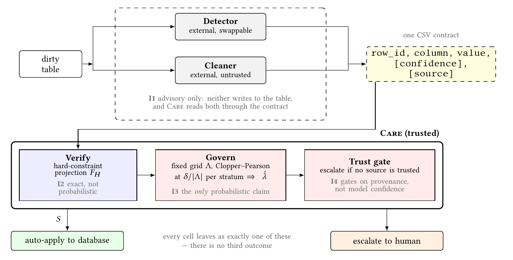

# CARE: Certifiable Automation for Data Repair

CARE is a governance layer between a data cleaner and the database. For each repair a
cleaner proposes, it decides whether the repair can be written without review or must be
escalated to a person, so that the error rate among the written repairs stays below a
budget α with probability at least 1−δ. CARE never runs or modifies the cleaner; it reads
the cleaner's output from one CSV file:

```
row_id, column, value, [confidence], [source]      # an empty value means "nothing to fix"
```

<p align="center"></p>

This repository contains the library, the evaluation harness, the logs of the six
cleaners studied in the paper (Baran, BClean, BClean+, HoloClean, GIDCL, ZeroEC) on five
benchmark tables, every result file, and scripts that regenerate every table and figure.

## Quick start

```bash
python3 -m venv .venv && source .venv/bin/activate
pip install -r requirements.txt && pip install -e .
pytest -q                    # unit and property tests
./reproduce.sh --quick       # all results except tax and the error-rate sweep
./reproduce.sh               # everything (tax needs about 16 GB of RAM)
./reproduce.sh --verify      # only check that stored results regenerate
./reproduce.sh --from 6      # resume a run at step 6
```

On Windows use `reproduce.ps1` with `-Quick` or `-Verify`. No GPU or API key is needed:
everything is replayed from the logs in `csvs/`.

The benchmark tables (hospital, beers, flights, rayyan, tax) are the Raha/Baran suite
and are not redistributed; `bench/datasets.py` downloads them into `data/` on first use,
and the full run imports Ni et al.'s error-rate variants the same way (needs `git`).
The certification path needs only `pydantic`; `matplotlib` is needed for figures.

## Layout

| path | contents |
|---|---|
| `care/` | the library: Learn-then-Test threshold search, Clopper–Pearson bounds, strata, constraint verification (exact and incremental), trust gate, label planner |
| `bench/` | evaluation harness: `run_study` (sweeps), the evaluation protocol, dataset loader, throughput |
| `csvs/` | cleaner logs: `<cleaner>_<table>_pred.csv` as exported, `_mapped.csv` after schema mapping; detector queues; Baran's extra draws (`baran_var_*/`); error-rate variants (`*_ni_*`) |
| `experiments/` | result CSVs; every number in the paper is read from these (`experiments/README.md`) |
| `paper/` | figures and tables written by `make_figures.py` |
| `audit_*.py`, `tools/` | audit and verification scripts |
| `integrations/` | exporters that produced each log, run inside each cleaner's own repository |
| `tests/` | unit and property tests |
| `docs/REPRODUCE.md` | environments, how each log was produced, protocol decisions |

## One sweep by hand

```bash
python prepare_log.py tax csvs/baran_tax_pred.csv          # map to CARE's schema and validate
python -m bench.run_study --dataset tax \
  --backends "baran:csvs/baran_tax_mapped.csv" \
  --experiment pareto --alphas 0.05 0.1 0.2 --seeds 10 \
  --scoring errors --fast-verify on --out experiments/results_baran_errors
python make_figures.py
```

Use `--detection log:csvs/raha_<table>_detected.csv` for a real detector's queue instead
of the true error cells. Each result row reports CARE and the two baselines, apply-all
(write everything) and escalate-all (review everything).

## Adding a cleaner

Write an exporter that emits the contract above (`integrations/README.md`), then run
`bash integrations/sweep_offline_logs.sh <cleaner> <table>...`. An empty `value` tells
CARE the cleaner abstains on that cell; `confidence` lets CARE certify part of a column;
`source` feeds the trust gate.

## Hardware

All runs used one NVIDIA DGX Spark (GB10, 128 GB unified memory, Ubuntu 24.04). CARE is
pure Python (3.10 or later).

## License

Apache License 2.0 (`LICENSE`). The benchmark tables and the cleaners keep their own
licenses; this repository contains none of their code, only the logs their runs produced.
